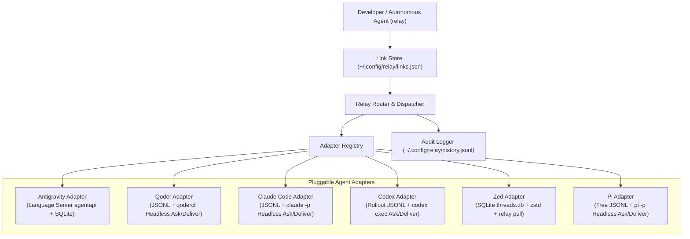
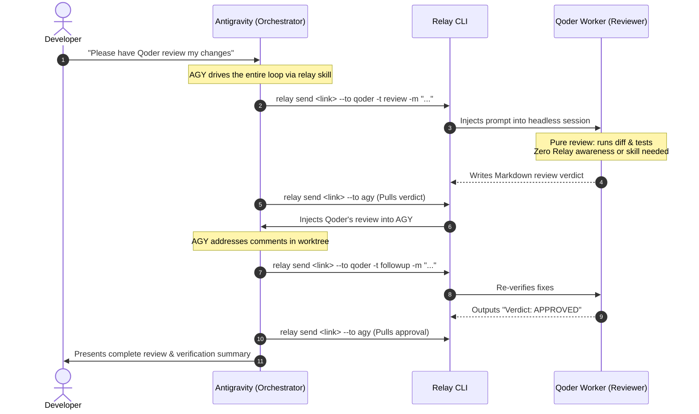

# Relay

> **Universal, zero-dependency, cross-agent communication CLI for AI coding assistants.**

[](https://go.dev)
[](LICENSE)
[](#core-design-principles)

`relay` enables disparate AI coding agents (such as **Google Antigravity**, **Claude Code**, **OpenAI Codex CLI**, **Zed native Agent (`zed`)**, **Pi Coding Agent (`pi` / Zed `pi-acp`)**, and **Qoder CLI / Headless Worker**) to directly communicate, conduct automated code reviews, inspect live worktrees, steer running workers, and collaborate in the background—eliminating the need for human copy-pasting between chat windows.

---

## The Problem: The "Human Clipboard" Bottleneck

Modern engineering workflows increasingly combine specialized AI agents side-by-side in the same repository:
- **Google Antigravity**: Fast autonomous implementation, workspace refactoring, test execution.
- **Qoder (CLI & Headless Worker)**: Rigorous gatekeeper reviews, architectural compliance, multi-file verification.
- **Claude Code / Codex**: Deep exploration, secondary perspectives, research.

Even though agents share the same codebase on disk, **their conversation sessions and runtimes remain completely isolated silos**. Developers are stuck acting as **manual relays ("二传手")**:

1. Wait for Agent A (e.g., Antigravity) to finish implementation in its chat window.
2. Switch windows to Agent B (e.g., Qoder), manually prompting it: *"Review the latest changes on branch X."*
3. Wait for Agent B to complete its analysis.
4. Manually scroll through the chat, copy multi-kilobyte Markdown review findings, switch back to Agent A's window, and paste them in.
5. Repeat this tedious round-trip loop across every iteration.

`relay` breaks this silo by providing **direct session-to-session communication**, letting agents pass task directives, completions, and review reports to each other in the background without stealing desktop focus.

---

## Core Features

- **Zero Daemons & Single Binary**: Written in pure Go, CGO-free, requiring no persistent background services or external runtime dependencies.
- **Session Mesh Architecture**: Create explicit, named, bidirectional communication channels (`Links`) between any two agent sessions across arbitrary topologies, automatically sorted by latest activity (`LAST RELAY`).
- **Headless Peer Reviews**: Interacts directly with [Qoder CLI](https://qoder.com/cli) (`qodercli`) and the headless worker runtime (`qoder-worker-runtime`); reviews happen entirely in the background without needing the desktop GUI app open.
- **Prompt Templates & Dual-Engine Verification**: Built-in prompt templates (`review`, `followup`) that automatically drive structured code reviews (`/verification-before-completion`, combining `ponytail-review` with architectural guardrails like `mopheus-code-review`), plus extensible custom templates.
- **Transparent Cross-Boundary Support**: Automatically resolves Windows WSL / Linux / macOS boundary friction (reading desktop SQLite databases with WAL locks, auto-discovering Antigravity Language Server endpoints via `/proc`, and managing permissions).
- **Concurrency & Safety**: File-locking (`flock`) prevents race conditions on link state, non-blocking OS lease-lock probing prevents premature output extraction, and fail-closed credential discovery protects tokens.
- **Complete Audit Trail**: Append-only transaction logging (`~/.config/relay/history.jsonl`) tracking full payloads, delivery status, timestamps, and error diagnostics.

---

## Supported Agents & Capability Matrix

Relay separates **who initiates a call (Caller)** from **who executes a headless turn (Receiver)**:

- **Caller (`relay ask` / `relay peek` / `relay steer`)**: **Any agent or shell that can run bash** works out of the box—no source session adapter or link is required.
- **Receiver (`relay ask <target>`)**: Requires a headless-capable target adapter that executes a turn and returns the reply synchronously.

| Agent (Aliases) | Caller (`relay ask` / `peek` / `steer`) | Receiver (`relay ask <target>`) | Session Inspect (`session list` / `peek`) | Link Mode (`send` / `pull`) | Mid-Turn Steering (`steer` + `hook-install`) |
| :--- | :---: | :---: | :---: | :---: | :---: |
| **Qoder CLI** (`qoder`, `qoderwork`, `qw`) | ✅ | ✅ (`qodercli -p -f json`) | ✅ | ✅ Source & Target | ✅ `settings.json` `PostToolUse` |
| **Claude Code** (`claude`, `claudecode`) | ✅ | ✅ (`claude -p --output-format json`) | ✅ | ✅ Source & Target | ✅ `settings.json` (+ detects `settings.local.json`) |
| **OpenAI Codex CLI** (`codex`) | ✅ | ✅ (`codex exec --json -o`) | ✅ | ✅ Source & Target | ❌ (uses separate `hooks.json`) |
| **Pi Coding Agent** (`pi`, `pi-agent`) | ✅ | ✅ (`pi -p --session`) | ✅ | ✅ (`pull` in Zed `pi-acp`; `send` headless) | ✅ `extensions/relay-steer.ts` (`deliverAs: "steer"`) |
| **Google Antigravity** (`antigravity`, `agy`) | ✅ | ❌ (IDE async LS only) | ✅ | ✅ Source & Async Target (`send --to agy`) | ➖ (use `send --to agy` queue) |
| **Zed Native Agent** (`zed`, `zed-agent`) | ✅ | ❌ (GUI-only, no headless CLI) | ✅ | ⚠️ Source only (`ask` / `pull`) | ❌ |
| **Any Other CLI / Agent / Shell** (Cursor, OpenCode, Qwen, Kimi, CI, human terminal) | ✅ | ❌ | ❌ | ❌ | ❌ |

> **Example**: Inside **Google Antigravity**, **Claude Code**, **Zed**, or a **human terminal**, you are the **Caller**—run `relay ask qoder -w .worktrees/feat-x -t review -m "..."` directly. To push a reply asynchronously into an open Antigravity IDE chat window, use `relay link` + `relay send <link> --to agy`.

---

## Architecture Overview



### The Asymmetric Orchestrator-Worker Pattern (Why Reviewers Never Touch Relay)

In practical workflows, developers interact primarily with **one primary agent** (e.g., Google Antigravity). Relay is deliberately architected as an **Asymmetric Orchestrator-Worker pipeline** rather than symmetric peer-to-peer chat:



#### Why the Reviewer Agent Never Uses Relay:
1. **Zero-Invasion on Reviewer**: Qoder operates 100% as a standard code reviewer. It requires **no Relay skill, no CLI installation in its context, and zero awareness of link names or session IDs**. It only needs to do what it does best: inspect diffs, verify architectural compliance, and run tests.
2. **Single-Ended Orchestration (Zero Deadlocks)**: All lifecycle transitions (`dispatch review -> pull verdict -> fix code -> dispatch followup -> pull approval`) are deterministically driven by the active Orchestrator. This eliminates multi-agent race conditions, session lock contention, or split-brain deadlocks.
3. **Single-Pane Experience**: The human developer never leaves their primary IDE chat window. Antigravity acts as the active driver, delegating to Qoder in the background and presenting the final result.

---

## Installation

### Prerequisites
- **Go 1.22+**
- **Google Antigravity** (IDE running locally)
- **Qoder CLI** (standalone `qodercli` or the runtime bundled with Qoder Desktop)

### Install via Source
```bash
git clone https://github.com/kamusis/relay.git
cd relay
make install
```
This builds and installs the binary to `~/.local/bin/relay` (or `$GOBIN`).

Ensure `~/.local/bin` is in your `PATH`:
```bash
export PATH=$PATH:$HOME/.local/bin
```

---

## Quick Start

> [!TIP]
> **Autonomous Agent Mode vs. Manual CLI Mode**
> In daily development, **you don't even need to run these CLI commands manually**. Simply tell Antigravity in your chat window: *"Have Qoder review my changes"*. 
> Antigravity will autonomously discover sessions, create the link, dispatch the `-t review` request, pull the verdict via `relay send --to agy`, fix blocking issues, and follow up until approved.
> The manual CLI steps below show what Antigravity executes under the hood (and what human developers can run from a terminal).

### 1. Discover Active Sessions
Inspect conversation sessions across all connected agents in the current workspace:
```bash
relay session list
```
Output:
```text
AGENT         SESSION ID                            UPDATED    TITLE                            WORKSPACE
antigravity   3dfb0b87-f23a-4dc7-b7e5-27677ced4323  2m ago     Feature Implementation           /path/to/project
qoder         e959378f-57da-496f-93e2-ff7092aa1e02  5m ago     Repository Architecture Review   /path/to/project
```

### 2. Establish a Named Link
Link the Antigravity coder session and the Qoder reviewer session:
```bash
relay link create dev-review 3dfb0b87 e959378f
```

View active links (automatically sorted by most recently active `LAST RELAY`):
```bash
relay link list
```
Output:
```text
LINK        ENDPOINT A                                   ENDPOINT B                                   LAST RELAY
dev-review  antigravity:3dfb0b87 (Feature Implementation) qoder:e959378f (Architecture Review)         -
```

### 3. Relay Review Request to Reviewer
Send a review request using the built-in **`review` template** to automatically drive dual-engine verification:
```bash
# Template Mode: wraps prompt with /verification-before-completion directives
relay send dev-review --to qoder -t review -m "Commit: 28ef9212 on main\nWorktree: .worktrees/auth-refactor"

# Or Direct Message Mode: sends freeform message without template
relay send dev-review --to qoder -m "Please check if there are any race conditions in this helper"
```
Qoder runs headlessly in the background, executing verification tools (`git log`, `go test`, file inspections) and producing an authoritative review report.

### 4. Relay Review Verdict Back to Coder
Once Qoder finishes, relay its review findings back to Antigravity:
```bash
# Pure forwarding mode: injects Qoder's complete review verdict into Antigravity
relay send dev-review --to agy

# Or forward and annotate with a directive:
relay send dev-review --to agy -m "Please address priority items from Qoder's review" --append
```
Antigravity receives the complete Markdown review directly in its conversation context and begins applying fixes.

### 5. Multi-Round Follow-up (Follow-up Review)
If Qoder requested changes, send the fix verification using the **`followup` template**:
```bash
relay send dev-review --to qoder -t followup -m "Addressed all blocking review comments; all unit tests pass"
```
Once Qoder gives the final approval (`Verdict: APPROVED`), pull the confirmation back:
```bash
relay send dev-review --to agy
```

### 6. Inspect Audit Log
```bash
relay log dev-review -n 5
```
Output:
```text
TIME                 LINK        DIRECTION             STATUS     PROMPT                BODY SNIPPET
2026-11-01 00:36:33  dev-review  qoder -> antigravity  delivered  Here is Qoder's rev... ## Independent Verification...
2026-11-01 00:33:23  dev-review  antigravity -> qoder  delivered  Please review the l... Completed all targeted fixes...
```

---

## Command Reference

### `relay ask` (Default Linkless Workflow)
Send a prompt directly to any headless-capable target agent (`qoder`, `claude`, `codex`, `pi`) without creating a link or requiring a source session adapter. Prints the reviewer's clean reply to `stdout`, prints session/audit provenance to `stderr`, and logs every turn in `$RELAY_HOME/history.jsonl` (`link_name: "ask"`).
```bash
# Round 1: auto-reuses latest Qoder session for the worktree (or creates a new one in one turn)
relay ask qoder -w .worktrees/fix-auth -t review -m "Review auth token refresh fix"

# Round 2: continue the exact session returned on stderr
relay ask qoder:2a037e6d -t followup -m "Fixed B1 and B2; go test -race passes"

# Ask Claude Code, Codex, or Pi directly (pass --new to force a fresh session)
relay ask claude --new -w . -m "Check nil pointer edge cases in pkg/steer"
relay ask codex -w . -t review -m "Verify lock ordering"
relay ask pi -w . -m "Summarize recent commits" --json
```

### `relay session list`
Discover local conversation sessions.
```bash
# List sessions for current directory workspace
relay session list

# Filter by workspace directory
relay session list -w /path/to/repo

# Filter by specific agent (agy, zed, qoder, claude, codex, pi)
relay session list --agent qoder

# List global / scratch sessions without a workspace
relay session list -g
```

### `relay link` (Optional Bidirectional Channel Mode)
Manage named bidirectional communication channels for bridging two live chat sessions from an external terminal or asynchronously pushing messages into an Antigravity chat pane. Links are sorted by `LAST RELAY` activity descending.
```bash
# Create a link (supports UUID prefixes)
relay link create <link-name> <session-a> <session-b>

# List all links with last relay status (most active links first)
relay link list

# Force live re-verification of session existence across adapters
relay link list -r

# Delete a link
relay link rm <link-name>
```

### `relay send`
Transmit outputs or explicit messages between linked agents.
```bash
# 1. Direct Message Mode (sends freeform message, bypasses source transcript & busy checks)
relay send <link-name> --to <target-agent> -m "Review commit 28ef9212 focusing on security"

# 2. Template-Driven Review Mode (applies template to structure the review request)
relay send <link-name> --to <target-agent> -t review -m "Ticket: MOC-102\nWorktree: .worktrees/auth"

# 3. Follow-up Review Mode (verifies closure of blocking items from previous rounds)
relay send <link-name> --to <target-agent> -t followup -m "Fixed parser boundary regression"

# 4. Pure Forwarding Mode (automatically extracts counterpart's latest assistant output)
relay send <link-name> --to <target-agent>

# 5. Forward + Append Mode (extracts counterpart's latest output and annotates with directive)
relay send <link-name> --to <target-agent> -m "Please address priority items" --append
```

### `relay pull`
Pull the latest completed assistant output from a linked counterpart cleanly to `stdout` (with audit logging in `history.jsonl` and provenance on `stderr`). Ideal when orchestrating from an active editor session such as Zed native Agent (`zed`) or Pi in Zed (`pi-acp`).
```bash
# Pull Qoder's latest review verdict into the current Zed or Pi session
relay pull <link-name> --from qoder
```

### `relay peek`
Capture a read-only live progress snapshot for a worktree directory, an agent session (`<agent>:<session_id>`), or a link name — even while the worker's turn is still in progress. Combines Git branch/commits/dirty files/diff, sibling worktrees, live session status (`working`/`idle`), and pending steers.
```bash
# Inspect a feature worktree with file-filtered unified diff
relay peek .worktrees/fix-auth --diff -f server/auth.go

# Inspect a live agent session or link (supports --json for supervision loops)
relay peek zed:8878e5d3
relay peek qoder:e09937bb --diff --json
relay peek review-mopheus
```

### `relay steer`
Queue and drain mid-turn steering directives for hook-capable agents (Claude Code, Qoder CLI, Pi) via a cross-process locked queue (`$RELAY_HOME/steer.jsonl`, defaulting to `~/.config/relay/steer.jsonl`).
```bash
# Queue a mid-turn correction targeting a worktree (matches subdirectories) or session
relay steer .worktrees/fix-auth -m "Use /usr/sbin/ioreg instead of bare ioreg" --blocking
relay steer qoder:e09937bb -m "Add empty-PATH test assertion"

# Inspect or cancel pending directives
relay steer list [--all] [--json]
relay steer clear [target] [--id <prefix>]

# Atomically consume pending directives inside a PostToolUse hook
relay steer drain --format hook-json --read-hook-stdin

# Install, inspect, or remove steering hooks/extensions automatically
# (Claude Code & Qoder CLI: settings.json PostToolUse; Pi: extensions/relay-steer.ts)
relay steer hook-install --agent all          # or --agent claude / qoder / pi
relay steer hook-install --status
relay steer hook-install --agent all --uninstall

# Or print a copy-pasteable hook / Pi TypeScript extension snippet
relay steer hook-snippet --agent claude       # or qoder / pi
```

> **Isolated State (`RELAY_HOME`)**: Set `RELAY_HOME=/path/to/dir` to override the default `~/.config/relay` state directory for `links.json`, `history.jsonl`, `steer.jsonl`, and `templates/` (useful for CI, tests, or sandboxed agent runtimes).

### `relay template`
Manage and preview prompt templates for relay transmissions.
```bash
# List all available templates (both built-in and user-customized)
relay template list

# Inspect the content and metadata of a template
relay template show review
relay template show followup
relay template show supervise
```

### `relay log`
Inspect append-only audit history.
```bash
# View recent transmissions
relay log [link-name] [-n <limit>]

# Inspect complete raw payload for a specific transmission UUID
relay log --show <transmission-uuid>
```

---

## Prompt Templates & Customization

Relay includes a built-in template engine to standardize agent-to-agent prompts, ensuring peer reviews strictly comply with code quality guardrails.

### Built-in Templates

| Template | Purpose | Use Case |
|---|---|---|
| **`review`** | Initial dual-engine code review | Drives `/verification-before-completion`: runs **Phase A** `ponytail-review` (Lean, caller blast radius, anti-bloat) and **Phase B** architectural compliance (`mopheus-code-review` or repository guardrails). |
| **`followup`** | Follow-up review across rounds | Verifies closure of [Blocking] items from previous rounds, checks for regressions, and requests final verdict (`APPROVED`). |
| **`supervise`** | Live mid-turn supervision | Guides a supervisor agent to inspect in-flight work via `relay peek --diff` and invoke `relay steer` only on high-confidence defects (bugs, security/path boundaries, broken invariants). |

### Adding Custom Templates (No Code Changes Needed)

You can add your own prompt templates without modifying or recompiling Relay.

#### Option 1: Global Templates Directory (`~/.config/relay/templates/`)
Drop any `.tmpl`, `.md`, or `.txt` file into `~/.config/relay/templates/`:

```bash
mkdir -p ~/.config/relay/templates

# Example: create a security audit template
cat << 'EOF' > ~/.config/relay/templates/security.tmpl
请针对以下改动执行深度安全审查（OWASP Top 10、SQL 注入、鉴权逃逸与越权）：

{{if .Message}}
---
【审查重点】
{{.Message}}
{{end}}
EOF
```

Relay automatically discovers it immediately:
```bash
❯ relay template list
NAME      SOURCE                                            DESCRIPTION
followup  builtin                                           Follow-up review verifying closure...
review    builtin                                           Initial dual-engine code review...
security  ~/.config/relay/templates/security.tmpl           Custom template from ...
```

Then invoke it via `-t`:
```bash
relay send dev-review --to qoder -t security -m "重点检查新加的 RPC 接口参数校验"
```

> **Overriding Built-ins**: If you place a file named `review.tmpl` in `~/.config/relay/templates/`, Relay will prioritize your custom template over the built-in one.

#### Option 2: Direct File Path
You can also supply an arbitrary relative or absolute file path to `-t`:
```bash
relay send dev-review --to qoder -t ./prompts/pr-audit.md -m "PR #42 scope"
```

### Template Syntax & Available Variables

Templates use standard Go `text/template` syntax and have access to the following variables:

| Variable | Description | Example |
|---|---|---|
| `{{.Message}}` | Content passed via the `-m` CLI flag | `Ticket: MOC-102\nWorktree: ...` |
| `{{.Link}}` | Name of the active link channel | `dev-review` |
| `{{.Output}}` | Extracted counterpart output (when `--append` is used) | Markdown report text |
| `{{.FromAgent}}` | Originating agent name | `antigravity` |
| `{{.ToAgent}}` | Destination agent name | `qoder` |

*Note: If your template is a plain text/markdown file without `{{...}}` tags, Relay will automatically and safely append your `-m` message to the end of the template.*

---

## Agent Integration Details

### Google Antigravity
- **Discovery**: Automatically locates running `language_server` instances by inspecting `/proc` on Linux or `ps`/`lsof` on macOS.
- **Authentication**: Dynamically extracts CSRF tokens and port bindings, validating endpoints with fail-closed semantics.
- **Delivery**: Dispatches messages directly into the IDE extension runtime via `agentapi send-message`.

### Qoder (CLI & Headless Worker)
- **Supported Surfaces**: Operates directly via the standalone [Qoder CLI](https://qoder.com/cli) (`qodercli`), with automatic fallback to the headless worker runtime (`qoder-worker-runtime`) bundled with [Qoder](https://qoder.com/qoder) desktop.
- **Headless Execution**: Runs in non-interactive mode (`-p` / `--print`) with `--dangerously-skip-permissions` to allow automated verification tools (`git`, `go test`, `grep`) to execute without interactive stalls.
- **Zero GUI Dependency**: Executes directly against `~/.qoder/projects/` session storage. The desktop IDE does not need to be running, though desktop-created sessions and titles are automatically discovered from local SQLite databases.

### Zed Native Agent (`zed`)
- **Session Storage**: Reads Zed's local SQLite database (`threads.db`) read-only across macOS (`~/Library/Application Support/Zed/threads/threads.db`), Linux (`$XDG_DATA_HOME/zed/threads/threads.db`), and Windows/WSL (`%LOCALAPPDATA%/Zed/threads/threads.db`), decompressing `zstd` thread payloads in pure Go (`klauspost/compress/zstd`).
- **Workspace & Subagent Handling**: Filters top-level threads (`parent_id IS NULL`), matches `folder_paths` (falling back to `initial_project_snapshot.worktree_snapshots` for legacy threads), and skips `Thinking` blocks / `"Resume"` markers when extracting assistant text.
- **Orchestrator Workflow**: Link `zed:<thread-id>` to `qoder:<session-id>`, dispatch reviews via `relay send --to qoder -t review -m "..."`, and pull verdicts synchronously via `relay pull <link> --from qoder` (direct push via `relay send --to zed` is intentionally disabled to avoid mutating Zed's live `threads.db`).

### Pi Coding Agent (`pi` / Zed `pi-acp`)
- **Session Storage**: Reads Pi v3 tree-structured JSONL sessions directly from `~/.pi/agent/sessions/` (honoring `PI_CODING_AGENT_DIR` and `PI_CODING_AGENT_SESSION_DIR`), walking `parentId` chains from the active leaf so abandoned `/tree` branches are never read.
- **Zed Orchestrator Workflow**: Inside Zed (`pi-acp`), Pi exposes `$PI_SESSION_ID` to its bash tool. Link `pi:$PI_SESSION_ID` to `qoder:<id>`, dispatch reviews via `relay send --to qoder -t review`, and consume verdicts synchronously via `relay pull <link> --from qoder` (avoiding external writes to `pi-acp`'s in-memory session tree).
- **Headless Worker Delivery**: For background Pi sessions not open in Zed, `relay send --to pi` invokes `pi -p --session <session-file> -- <payload>`.

### Hook & Extension Integration (Mid-Turn Steering)
- **Trigger Scope (Low Overhead)**: Steering drains only run after mutating or command-execution tool calls — `Edit|Write|MultiEdit|Bash` for Claude Code and Qoder CLI (`PostToolUse` hook), and `edit` / `write` / `bash` for Pi (`tool_result` extension). Read-only tools (`Read`, `Grep`, `Glob`) do not invoke `relay`.
- **One-Time Setup**: Run `relay steer hook-install --agent all` (or `--agent claude` / `qoder` / `pi`, with `--scope user` default or `--scope project`) to idempotently install:
  - **Claude Code & Qoder CLI**: merges the `PostToolUse` command hook into `~/.claude/settings.json` / `~/.qoder/settings.json` (or `<project>/.<agent>/settings.json`), preserving existing hooks, symlinks, and exact JSON numbers.
  - **Pi Coding Agent**: installs a managed TypeScript extension at `~/.pi/agent/extensions/relay-steer.ts` (or `<project>/.pi/extensions/relay-steer.ts`) that subscribes to `tool_result` and injects drained directives via Pi's native `pi.sendUserMessage(text, { deliverAs: "steer" })`.
  - Use `relay steer hook-snippet --agent claude|qoder|pi` for manual setup (e.g. `.claude/settings.local.json`).
- **Persistent Disk Queue (Not In-Memory)**: `relay steer` is a short-lived CLI that writes to `$RELAY_HOME/steer.jsonl` (default `~/.config/relay/steer.jsonl`) and exits immediately. Directives are persisted on disk under cross-process `flock` (`steer.jsonl.lock`) with atomic temp-file rename, surviving sender exit or restarts until consumed or cancelled via `relay steer clear`.
- **Exactly-Once Consumption & Zero-Noise Silence**: Under the exclusive file lock, `relay steer drain` atomically transitions every matching `pending` directive to `consumed` (recording `consumed_at`) and flushes `steer.jsonl` before returning. Subsequent tool calls see no `pending` entries and exit `0` with empty stdout (zero token overhead); concurrent tool hooks cannot consume the same directive twice. Consumed directives remain auditable via `relay steer list --all`.
- **Multi-Steer FIFO Batching**: When multiple `relay steer` directives are queued before the worker's next matching tool call, a single drain consumes all matching `pending` directives in FIFO order and merges them into one numbered `[Relay Steer — Mid-Turn Correction]` payload (`#1`, `#2`, … separated by `---`). If any directive in the batch has `--blocking`, the emitted `PostToolUse` JSON sets `decision: "block"` with all blocking reasons concatenated. Directives enqueued after that drain are delivered cleanly on the next matching tool call.
- **Missing-Hook Guard**: When `relay steer` targets `claude`, `qoder`, `pi`, or a workspace with no steering hook/extension detected (checking user scope, project scope, and `.claude/settings.local.json`), it prints an actionable warning on `stderr` pointing to `relay steer hook-install`.

---

## Configuration & Environment Variables

| Variable | Description | Default |
| :--- | :--- | :--- |
| `RELAY_HOME` | Override Relay state directory (`links.json`, `history.jsonl`, `steer.jsonl`, `templates/`) | `~/.config/relay` |
| `RELAY_DELIVERY_TIMEOUT` | Maximum execution timeout for target agent turns (e.g. `600s`, `15m`) | `600s` |
| `RELAY_STEER_TARGET` | Explicit steer target key matched during `relay steer drain` (e.g. `qoder:<id>` or `ws:<dir>`) | Auto-detected |
| `QODER_CLI_PATH` | Explicit path to `qodercli` binary | Auto-detected |
| `QODER_DB_PATH` | Explicit path to Qoder desktop `main.sqlite` database | Auto-detected |
| `CLAUDE_CLI_PATH` | Explicit path to `claude` binary | Auto-detected |
| `CLAUDE_CONFIG_DIR` | Override Claude Code configuration & projects root directory | `~/.claude` |
| `CODEX_CLI_PATH` | Explicit path to `codex` binary | Auto-detected |
| `CODEX_HOME` | Override Codex CLI state & sessions root directory | `~/.codex` |
| `PI_CLI_PATH` | Explicit path to `pi` CLI binary | Auto-detected |
| `PI_CODING_AGENT_DIR` | Override Pi agent configuration root directory | `~/.pi/agent` |
| `PI_CODING_AGENT_SESSION_DIR` | Override Pi session storage directory | `~/.pi/agent/sessions` |
| `ZED_THREADS_DB_PATH` | Explicit path to Zed native Agent `threads.db` database | Auto-detected |
| `ANTIGRAVITY_LS_ADDRESS` | Override Antigravity Language Server address (e.g. `127.0.0.1:44987`) | Auto-discovered |
| `ANTIGRAVITY_CSRF_TOKEN` | Override Antigravity Language Server CSRF token | Auto-discovered |

---

## Core Design Principles

1. **Stateless Execution**: `relay` runs, completes the command, and exits. No background memory footprint, no dangling listeners.
2. **Explicit Routing**: Every transmission explicitly specifies the link and target agent. No hidden state or accidental deliveries.
3. **Stale-Turn Protection**: Hard-fails if an agent's latest turn is in-progress, not generated by an assistant, or missing text content.
4. **Concurrency Safety**: Cross-process file locks (`flock`) ensure atomic mutations to `~/.config/relay/links.json` even under parallel agent execution.
5. **No CGO**: Compiled statically without CGO dependencies for instant cross-platform portability.

---

## Roadmap

- [x] Antigravity, Zed native Agent (`zed`), Qoder & Pi Coding Agent (`pi` / Zed `pi-acp`) adapters
- [x] Synchronous `relay pull` for active editor orchestrator sessions
- [x] Windows WSL / drvfs cross-boundary SQLite & credentials support
- [x] Autonomous Session & Link creation skill (`skills/relay/SKILL.md`)
- [x] Built-in & custom prompt templates (`review`, `followup`)
- [x] Audit trail with execution status and error diagnostics
- [ ] OpenAI Codex / Claude Code adapters

---

## License

MIT License. See [LICENSE](LICENSE) for details.
