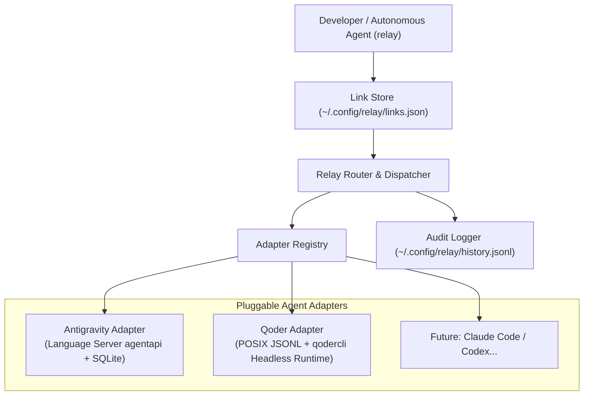
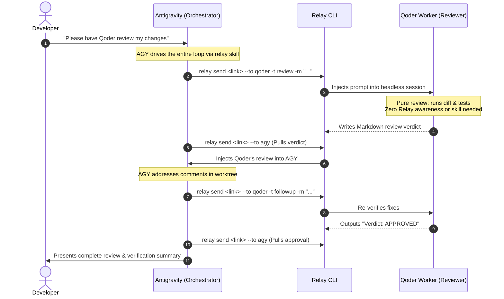

# Relay

> **Universal, zero-dependency, cross-agent communication CLI for AI coding assistants.**

[](https://go.dev)
[](LICENSE)
[](#core-design-principles)

`relay` enables disparate AI coding agents (such as **Google Antigravity** and **Qoder CLI / Headless Worker**) to directly communicate, conduct automated code reviews, exchange context, and collaborate in the background—eliminating the need for human copy-pasting between chat windows.

---

## The Problem: The "Human Clipboard" Bottleneck

Modern engineering workflows increasingly combine specialized AI agents side-by-side in the same repository:
- **Google Antigravity**: Fast autonomous implementation, workspace refactoring, test execution.
- **Qoder (CLI & Headless Worker)**: Rigorous gatekeeper reviews, architectural compliance, multi-file verification.
- **Claude Code / Codex**: Deep exploration, secondary perspectives, research.

Even though agents share the same codebase on disk, **their conversation sessions and runtimes remain completely isolated silos**. Developers are stuck acting as **manual relays ("二传手")**:

1. Wait for Agent A (e.g., Antigravity) to finish implementation in its chat window.
2. Switch windows to Agent B (e.g., Qoder), manually prompting it: *"Review the latest changes on branch X."*
3. Wait for Agent B to complete its analysis.
4. Manually scroll through the chat, copy multi-kilobyte Markdown review findings, switch back to Agent A's window, and paste them in.
5. Repeat this tedious round-trip loop across every iteration.

`relay` breaks this silo by providing **direct session-to-session communication**, letting agents pass task directives, completions, and review reports to each other in the background without stealing desktop focus.

---

## Core Features

- **Zero Daemons & Single Binary**: Written in pure Go, CGO-free, requiring no persistent background services or external runtime dependencies.
- **Session Mesh Architecture**: Create explicit, named, bidirectional communication channels (`Links`) between any two agent sessions across arbitrary topologies, automatically sorted by latest activity (`LAST RELAY`).
- **Headless Peer Reviews**: Interacts directly with [Qoder CLI](https://qoder.com/cli) (`qodercli`) and the headless worker runtime (`qoder-worker-runtime`); reviews happen entirely in the background without needing the desktop GUI app open.
- **Prompt Templates & Dual-Engine Verification**: Built-in prompt templates (`review`, `followup`) that automatically drive structured code reviews (`/verification-before-completion`, combining `ponytail-review` with architectural guardrails like `mopheus-code-review`), plus extensible custom templates.
- **Transparent Cross-Boundary Support**: Automatically resolves Windows WSL / Linux / macOS boundary friction (reading desktop SQLite databases with WAL locks, auto-discovering Antigravity Language Server endpoints via `/proc`, and managing permissions).
- **Concurrency & Safety**: File-locking (`flock`) prevents race conditions on link state, non-blocking OS lease-lock probing prevents premature output extraction, and fail-closed credential discovery protects tokens.
- **Complete Audit Trail**: Append-only transaction logging (`~/.config/relay/history.jsonl`) tracking full payloads, delivery status, timestamps, and error diagnostics.

---

## Architecture Overview



### The Asymmetric Orchestrator-Worker Pattern (Why Reviewers Never Touch Relay)

In practical workflows, developers interact primarily with **one primary agent** (e.g., Google Antigravity). Relay is deliberately architected as an **Asymmetric Orchestrator-Worker pipeline** rather than symmetric peer-to-peer chat:



#### Why the Reviewer Agent Never Uses Relay:
1. **Zero-Invasion on Reviewer**: Qoder operates 100% as a standard code reviewer. It requires **no Relay skill, no CLI installation in its context, and zero awareness of link names or session IDs**. It only needs to do what it does best: inspect diffs, verify architectural compliance, and run tests.
2. **Single-Ended Orchestration (Zero Deadlocks)**: All lifecycle transitions (`dispatch review -> pull verdict -> fix code -> dispatch followup -> pull approval`) are deterministically driven by the active Orchestrator. This eliminates multi-agent race conditions, session lock contention, or split-brain deadlocks.
3. **Single-Pane Experience**: The human developer never leaves their primary IDE chat window. Antigravity acts as the active driver, delegating to Qoder in the background and presenting the final result.

---

## Installation

### Prerequisites
- **Go 1.22+**
- **Google Antigravity** (IDE running locally)
- **Qoder CLI** (standalone `qodercli` or the runtime bundled with Qoder Desktop)

### Install via Source
```bash
git clone https://github.com/kamusis/relay.git
cd relay
make install
```
This builds and installs the binary to `~/.local/bin/relay` (or `$GOBIN`).

Ensure `~/.local/bin` is in your `PATH`:
```bash
export PATH=$PATH:$HOME/.local/bin
```

---

## Quick Start

> [!TIP]
> **Autonomous Agent Mode vs. Manual CLI Mode**
> In daily development, **you don't even need to run these CLI commands manually**. Simply tell Antigravity in your chat window: *"Have Qoder review my changes"*. 
> Antigravity will autonomously discover sessions, create the link, dispatch the `-t review` request, pull the verdict via `relay send --to agy`, fix blocking issues, and follow up until approved.
> The manual CLI steps below show what Antigravity executes under the hood (and what human developers can run from a terminal).

### 1. Discover Active Sessions
Inspect conversation sessions across all connected agents in the current workspace:
```bash
relay session list
```
Output:
```text
AGENT         SESSION ID                            UPDATED    TITLE                            WORKSPACE
antigravity   3dfb0b87-f23a-4dc7-b7e5-27677ced4323  2m ago     Feature Implementation           /path/to/project
qoder         e959378f-57da-496f-93e2-ff7092aa1e02  5m ago     Repository Architecture Review   /path/to/project
```

### 2. Establish a Named Link
Link the Antigravity coder session and the Qoder reviewer session:
```bash
relay link create dev-review 3dfb0b87 e959378f
```

View active links (automatically sorted by most recently active `LAST RELAY`):
```bash
relay link list
```
Output:
```text
LINK        ENDPOINT A                                   ENDPOINT B                                   LAST RELAY
dev-review  antigravity:3dfb0b87 (Feature Implementation) qoder:e959378f (Architecture Review)         -
```

### 3. Relay Review Request to Reviewer
Send a review request using the built-in **`review` template** to automatically drive dual-engine verification:
```bash
# Template Mode: wraps prompt with /verification-before-completion directives
relay send dev-review --to qoder -t review -m "Commit: 28ef9212 on main\nWorktree: .worktrees/auth-refactor"

# Or Direct Message Mode: sends freeform message without template
relay send dev-review --to qoder -m "Please check if there are any race conditions in this helper"
```
Qoder runs headlessly in the background, executing verification tools (`git log`, `go test`, file inspections) and producing an authoritative review report.

### 4. Relay Review Verdict Back to Coder
Once Qoder finishes, relay its review findings back to Antigravity:
```bash
# Pure forwarding mode: injects Qoder's complete review verdict into Antigravity
relay send dev-review --to agy

# Or forward and annotate with a directive:
relay send dev-review --to agy -m "Please address priority items from Qoder's review" --append
```
Antigravity receives the complete Markdown review directly in its conversation context and begins applying fixes.

### 5. Multi-Round Follow-up (Follow-up Review)
If Qoder requested changes, send the fix verification using the **`followup` template**:
```bash
relay send dev-review --to qoder -t followup -m "Addressed all blocking review comments; all unit tests pass"
```
Once Qoder gives the final approval (`Verdict: APPROVED`), pull the confirmation back:
```bash
relay send dev-review --to agy
```

### 6. Inspect Audit Log
```bash
relay log dev-review -n 5
```
Output:
```text
TIME                 LINK        DIRECTION             STATUS     PROMPT                BODY SNIPPET
2026-11-01 00:36:33  dev-review  qoder -> antigravity  delivered  Here is Qoder's rev... ## Independent Verification...
2026-11-01 00:33:23  dev-review  antigravity -> qoder  delivered  Please review the l... Completed all targeted fixes...
```

---

## Command Reference

### `relay session list`
Discover local conversation sessions.
```bash
# List sessions for current directory workspace
relay session list

# Filter by workspace directory
relay session list -w /path/to/repo

# Filter by specific agent (agy, qoder)
relay session list --agent qoder

# List global / scratch sessions without a workspace
relay session list -g
```

### `relay link`
Manage named communication channels. Links are sorted by `LAST RELAY` activity descending.
```bash
# Create a link (supports UUID prefixes)
relay link create <link-name> <session-a> <session-b>

# List all links with last relay status (most active links first)
relay link list

# Force live re-verification of session existence across adapters
relay link list -r

# Delete a link
relay link rm <link-name>
```

### `relay send`
Transmit outputs or explicit messages between linked agents.
```bash
# 1. Direct Message Mode (sends freeform message, bypasses source transcript & busy checks)
relay send <link-name> --to <target-agent> -m "Review commit 28ef9212 focusing on security"

# 2. Template-Driven Review Mode (applies template to structure the review request)
relay send <link-name> --to <target-agent> -t review -m "Ticket: MOC-102\nWorktree: .worktrees/auth"

# 3. Follow-up Review Mode (verifies closure of blocking items from previous rounds)
relay send <link-name> --to <target-agent> -t followup -m "Fixed parser boundary regression"

# 4. Pure Forwarding Mode (automatically extracts counterpart's latest assistant output)
relay send <link-name> --to <target-agent>

# 5. Forward + Append Mode (extracts counterpart's latest output and annotates with directive)
relay send <link-name> --to <target-agent> -m "Please address priority items" --append
```

### `relay template`
Manage and preview prompt templates for relay transmissions.
```bash
# List all available templates (both built-in and user-customized)
relay template list

# Inspect the content and metadata of a template
relay template show review
relay template show followup
```

### `relay log`
Inspect append-only audit history.
```bash
# View recent transmissions
relay log [link-name] [-n <limit>]

# Inspect complete raw payload for a specific transmission UUID
relay log --show <transmission-uuid>
```

---

## Prompt Templates & Customization

Relay includes a built-in template engine to standardize agent-to-agent prompts, ensuring peer reviews strictly comply with code quality guardrails.

### Built-in Templates

| Template | Purpose | Use Case |
|---|---|---|
| **`review`** | Initial dual-engine code review | Drives `/verification-before-completion`: runs **Phase A** `ponytail-review` (Lean, caller blast radius, anti-bloat) and **Phase B** architectural compliance (`mopheus-code-review` or repository guardrails). |
| **`followup`** | Follow-up review across rounds | Verifies closure of [Blocking] items from previous rounds, checks for regressions, and requests final verdict (`APPROVED`). |

### Adding Custom Templates (No Code Changes Needed)

You can add your own prompt templates without modifying or recompiling Relay.

#### Option 1: Global Templates Directory (`~/.config/relay/templates/`)
Drop any `.tmpl`, `.md`, or `.txt` file into `~/.config/relay/templates/`:

```bash
mkdir -p ~/.config/relay/templates

# Example: create a security audit template
cat << 'EOF' > ~/.config/relay/templates/security.tmpl
请针对以下改动执行深度安全审查（OWASP Top 10、SQL 注入、鉴权逃逸与越权）：

{{if .Message}}
---
【审查重点】
{{.Message}}
{{end}}
EOF
```

Relay automatically discovers it immediately:
```bash
❯ relay template list
NAME      SOURCE                                            DESCRIPTION
followup  builtin                                           Follow-up review verifying closure...
review    builtin                                           Initial dual-engine code review...
security  ~/.config/relay/templates/security.tmpl           Custom template from ...
```

Then invoke it via `-t`:
```bash
relay send dev-review --to qoder -t security -m "重点检查新加的 RPC 接口参数校验"
```

> **Overriding Built-ins**: If you place a file named `review.tmpl` in `~/.config/relay/templates/`, Relay will prioritize your custom template over the built-in one.

#### Option 2: Direct File Path
You can also supply an arbitrary relative or absolute file path to `-t`:
```bash
relay send dev-review --to qoder -t ./prompts/pr-audit.md -m "PR #42 scope"
```

### Template Syntax & Available Variables

Templates use standard Go `text/template` syntax and have access to the following variables:

| Variable | Description | Example |
|---|---|---|
| `{{.Message}}` | Content passed via the `-m` CLI flag | `Ticket: MOC-102\nWorktree: ...` |
| `{{.Link}}` | Name of the active link channel | `dev-review` |
| `{{.Output}}` | Extracted counterpart output (when `--append` is used) | Markdown report text |
| `{{.FromAgent}}` | Originating agent name | `antigravity` |
| `{{.ToAgent}}` | Destination agent name | `qoder` |

*Note: If your template is a plain text/markdown file without `{{...}}` tags, Relay will automatically and safely append your `-m` message to the end of the template.*

---

## Agent Integration Details

### Google Antigravity
- **Discovery**: Automatically locates running `language_server` instances by inspecting `/proc` on Linux or `ps`/`lsof` on macOS.
- **Authentication**: Dynamically extracts CSRF tokens and port bindings, validating endpoints with fail-closed semantics.
- **Delivery**: Dispatches messages directly into the IDE extension runtime via `agentapi send-message`.

### Qoder (CLI & Headless Worker)
- **Supported Surfaces**: Operates directly via the standalone [Qoder CLI](https://qoder.com/cli) (`qodercli`), with automatic fallback to the headless worker runtime (`qoder-worker-runtime`) bundled with [Qoder](https://qoder.com/qoder) desktop.
- **Headless Execution**: Runs in non-interactive mode (`-p` / `--print`) with `--dangerously-skip-permissions` to allow automated verification tools (`git`, `go test`, `grep`) to execute without interactive stalls.
- **Zero GUI Dependency**: Executes directly against `~/.qoder/projects/` session storage. The desktop IDE does not need to be running, though desktop-created sessions and titles are automatically discovered from local SQLite databases.

---

## Configuration & Environment Variables

| Variable | Description | Default |
| :--- | :--- | :--- |
| `RELAY_DELIVERY_TIMEOUT` | Maximum execution timeout for target agent turns (e.g. `300s`, `10m`) | `300s` |
| `QODER_CLI_PATH` | Explicit path to `qodercli` binary | Auto-detected |
| `QODER_DB_PATH` | Explicit path to Qoder desktop `main.sqlite` database | Auto-detected |
| `ANTIGRAVITY_LS_ADDRESS` | Override Antigravity Language Server address (e.g. `127.0.0.1:44987`) | Auto-discovered |
| `ANTIGRAVITY_CSRF_TOKEN` | Override Antigravity Language Server CSRF token | Auto-discovered |

---

## Core Design Principles

1. **Stateless Execution**: `relay` runs, completes the command, and exits. No background memory footprint, no dangling listeners.
2. **Explicit Routing**: Every transmission explicitly specifies the link and target agent. No hidden state or accidental deliveries.
3. **Stale-Turn Protection**: Hard-fails if an agent's latest turn is in-progress, not generated by an assistant, or missing text content.
4. **Concurrency Safety**: Cross-process file locks (`flock`) ensure atomic mutations to `~/.config/relay/links.json` even under parallel agent execution.
5. **No CGO**: Compiled statically without CGO dependencies for instant cross-platform portability.

---

## Roadmap

- [x] Antigravity & Qoder bidirectional adapters
- [x] Windows WSL / drvfs cross-boundary SQLite & credentials support
- [x] Autonomous Session & Link creation skill (`skills/relay/SKILL.md`)
- [x] Built-in & custom prompt templates (`review`, `followup`)
- [x] Audit trail with execution status and error diagnostics
- [ ] OpenAI Codex / Claude Code adapters

---

## License

MIT License. See [LICENSE](LICENSE) for details.
