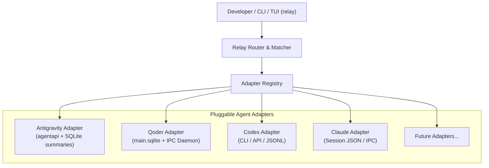

# Relay Architecture & Design Specification

> A universal, zero-dependency, cross-agent communication CLI & TUI for AI coding assistants.

---

## 1. Overview & Problem Statement

### 1.1 The "Human Clipboard" Bottleneck
Modern software engineering increasingly leverages multiple specialized AI coding agents side-by-side:
- **Google Antigravity**: Autonomous implementation, multi-file refactoring, fast workspace edits, test runs.
- **Qoder (QoderWork)**: Strict gatekeeper code reviews, policy enforcement, architectural compliance checks.
- **OpenAI Codex / Claude Code**: Deep exploration, domain research, or secondary implementation perspectives.

Currently, developers act as **manual relays ("二传手")**:
1. Wait for Agent A (e.g. Antigravity) to finish coding.
2. Manually copy branch names, git diffs, and context into Agent B (e.g. Qoder) to request a review.
3. Wait for Agent B to complete the review.
4. Manually scroll, copy multi-kilobyte markdown review findings (blocking items, line citations), and paste them into Agent A's conversation.
5. Repeat across iterations.

This manual process introduces friction, context clobbering, and user fatigue.

### 1.2 Mission of `relay`
`relay` provides a universal, single-binary CLI and TUI tool that allows disparate AI coding agents to **directly pass messages, tasks, and artifacts to each other in the background** without manual copy-pasting and without stealing desktop window focus.

---

## 2. Core Architecture & Extensible Design

`relay` adopts an **Adapter Driver Architecture** (inspired by Unix pipe semantics and modular driver registries), decoupling message routing and session alignment from specific agent implementations.



### 2.1 Unified Domain Models (`pkg/adapter/adapter.go`)

```go
package adapter

import "context"

type AgentType string

const (
    AgentAntigravity AgentType = "antigravity"
    AgentQoder       AgentType = "qoder"
    AgentCodex       AgentType = "codex"
    AgentClaude      AgentType = "claude"
)

type SessionState string

const (
    StateIdle    SessionState = "idle"
    StateRunning SessionState = "running"
    StateReady   SessionState = "ready"
)

// Session represents an active or historical agent conversation context.
type Session struct {
    ID        string       `json:"id"`
    Agent     AgentType    `json:"agent"`
    Title     string       `json:"title"`
    Workspace string       `json:"workspace"`
    GitBranch string       `json:"git_branch,omitempty"`
    State     SessionState `json:"state"`
    UpdatedAt int64        `json:"updated_at"`
}

// Message represents an inbound or outbound conversational turn.
type Message struct {
    SessionID string    `json:"session_id"`
    Agent     AgentType `json:"agent"`
    Role      string    `json:"role"`    // "assistant", "user", "system"
    Content   string    `json:"content"` // Plain text / Markdown
    Timestamp int64     `json:"timestamp"`
    Raw       any       `json:"raw,omitempty"`
}

// OutgoingPayload defines the standardized message packet sent to an agent.
type OutgoingPayload struct {
    Title    string            `json:"title,omitempty"`
    Content  string            `json:"content"`
    Metadata map[string]string `json:"metadata,omitempty"`
}

// Adapter defines the contract every AI agent driver must implement.
type Adapter interface {
    Type() AgentType
    DetectActiveSession(workspace string) (*Session, error)
    GetSession(sessionID string) (*Session, error)
    GetLatestAssistantMessage(sessionID string) (*Message, error)
    SendMessage(ctx context.Context, sessionID string, payload OutgoingPayload) error
    ListSessions(workspace string, limit int) ([]Session, error)
}
```

---

## 3. Agent Adapters & Reverse-Engineered Mechanics

### 3.1 Antigravity Adapter (`pkg/adapter/antigravity`)
- **Discovery**: Reads `~/.gemini/antigravity/conversation_summaries.db` (table `conversation_summaries`) to find conversations where `workspace_uris` matches the current workspace or git root.
- **Message Read**: Extracts assistant outputs from `~/.gemini/antigravity/brain/<id>/.system_generated/logs/transcript.jsonl`.
- **Message Injection (Reactive Wakeup)**: Executes the native Antigravity binary:
  ```bash
  ~/.gemini/antigravity/bin/agentapi send-message [--title=<title>] <conversation_id> <content>
  ```
  Injecting via `agentapi` triggers immediate model inference inside Antigravity without window activation.

### 3.2 Qoder Adapter (`pkg/adapter/qoder`)
- **Discovery**: Reads Windows host SQLite database at `file:/mnt/c/Users/kamus/AppData/Roaming/com.qoder.app.stable/main.sqlite?immutable=1` (table `chat_sessions`), matching on `cwd` and `git_branch`.
- **Message Read**: Queries `chat_session_messages` for the latest `role = 'assistant'` record, parsing JSON `parts[].text` into normalized Markdown findings.
- **Turn State Tracking**: Reads `chat-session-turn-payload-buffer.sqlite?immutable=1` (`active_turn_projection_items`) and `renderer.log` to detect state transitions (`running` -> `ready`).
- **Message Injection**: Connects to the active Windows named pipe:
  ```
  \\.\pipe\qoder-sdk-daemon-[uuid]
  ```
  Dispatching `sendMessageToChatSession` with `{ targetSessionId, prompt }` directly into Qoder's backend session loop.

### 3.3 Extensible Adapters (Codex, Claude Code)
- **Codex Adapter (`pkg/adapter/codex`)**: Interacts with Codex CLI headless daemon or JSONL execution transcript.
- **Claude Code Adapter (`pkg/adapter/claude`)**: Interacts with `~/.claude/projects/` session state or PTY execution.

---

## 4. CLI & TUI Interface Specification

### 4.1 CLI Commands

```bash
# 1. Inspect status of all agents in the current workspace
relay status

# 2. Point-to-point handoff
relay send --from qoder --to antigravity
relay send --from antigravity --to qoder [--prompt "..."]

# 3. Multi-agent chaining / pipeline
relay pipe antigravity codex qoder

# 4. Interactive Terminal UI
relay tui
```

### 4.2 TUI Experience (`relay tui`)
A lightweight, ANSI-rendered dual/tri-column dashboard:
```
=============================== RELAY: Agent Mesh ===============================
[ Qoder (Reviewer) ]                              [ Antigravity (Coder) ]
Session: Review branch feat/moc-1151              Session: Microsoft Teams Integration Support
ID:      3c58333e-7024...                         ID:      d4ddbec2-3749...
Status:  [READY - Review Complete]                Status:  [IDLE - Awaiting Review]
Summary: 4 blocking, 1 pre-existing items         Repo:    CascadeProjects/mopheus
---------------------------------------------------------------------------------
[Keybindings]
 [1] Handoff to Qoder (Ask Qoder to review current worktree/branch)
 [2] Handoff to Antigravity (Push Qoder review findings to AGY for fix)
 [A] Toggle Auto-Handoff Mode (Confirm before relay)
 [V] View latest exchanged message payload
 [Q] Quit
=================================================================================
```

---

## 5. Technical Stack & Build Constraints

1. **Language**: Go (1.26+)
2. **Binary Output**: Single statically-linked binary (`relay`) via:
   ```bash
   CGO_ENABLED=0 go build -ldflags="-s -w" -o relay ./cmd/relay
   ```
3. **SQLite Driver**: `modernc.org/sqlite` (Pure Go implementation, zero CGO/GCC requirement).
4. **Cross-Compilation**: Native support for Linux (`amd64`, `arm64`) and Windows (`relay.exe`).
5. **Zero Daemon Overhead**: Fast startup (< 5ms) when called from CLI or Agent tool bash calls.
