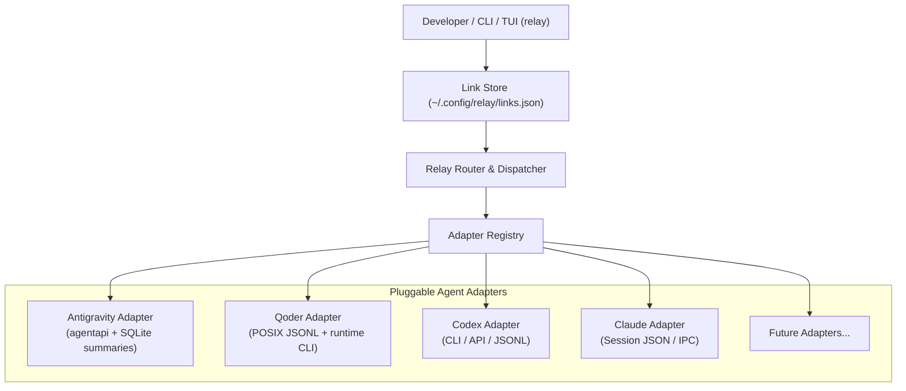
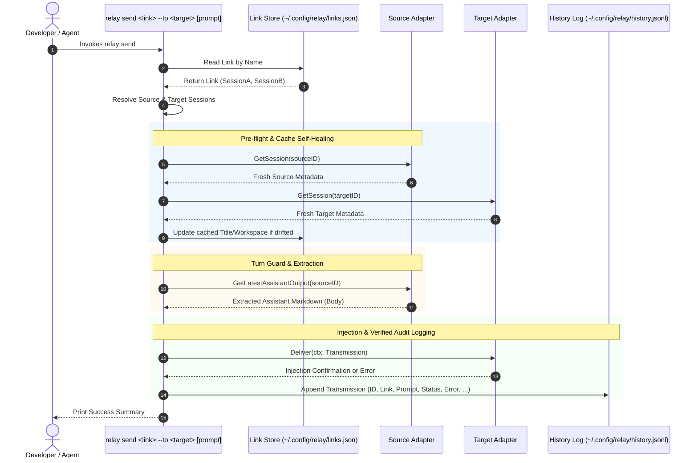

# Relay Architecture & Design Specification

> A universal, zero-dependency, cross-agent communication CLI & TUI for AI coding assistants.

---

## 1. Overview & Problem Statement

### 1.1 The "Human Clipboard" Bottleneck
Modern software engineering increasingly leverages multiple specialized AI coding agents side-by-side:
- **Google Antigravity**: Autonomous implementation, multi-file refactoring, fast workspace edits, test runs.
- **Qoder (QoderWork)**: Strict gatekeeper code reviews, policy enforcement, architectural compliance checks.
- **OpenAI Codex / Claude Code**: Deep exploration, domain research, or secondary implementation perspectives.

Currently, developers act as **manual relays ("二传手")**:
1. Wait for Agent A (e.g. Antigravity) to finish coding.
2. Manually copy branch names, git diffs, and context into Agent B (e.g. Qoder) to request a review.
3. Wait for Agent B to complete the review.
4. Manually scroll, copy multi-kilobyte markdown review findings (blocking items, line citations), and paste them into Agent A's conversation.
5. Repeat across iterations.

This manual process introduces friction, context clobbering, and user fatigue.

### 1.2 Mission of `relay`
`relay` provides a universal, single-binary CLI and TUI tool that allows disparate AI coding agents to **directly pass messages, tasks, and artifacts to each other in the background** without manual copy-pasting and without stealing desktop window focus.

---

## 2. Core Architecture: Session Mesh & Explicit Links

`relay` adopts a **Session Mesh Architecture with Explicit Links** (inspired by Unix pipe semantics and modular driver registries), decoupling message routing from specific agent implementations or implicit workspace guesswork.



### 2.1 First-Class Concepts & Invariants

1. **Session**:
   - Represents a specific conversation thread inside an Agent (`AgentType` + `ID` + title/workspace metadata).
   - Serves as the single authoritative model for both live discovery and link storage caching (no redundant `Endpoint` type).
2. **Link (Named Channel)**:
   - An explicit, named, bidirectional communication channel between two agent sessions (`Link { Name, SessionA, SessionB }`).
   - Persisted locally in `~/.config/relay/links.json`.
3. **Arbitrary Topology (Mesh)**:
   - Supports 1-to-1 pairs (`moc-qoder`: AGY Coder <-> Qoder Reviewer).
   - Supports 1-to-many stars (AGY Coder linked to both Qoder Reviewer and Codex Auditor via separate links `moc-qoder` and `moc-codex`).
   - Supports intra-agent links (AGY Planner <-> AGY Worker).
4. **Stateless Execution**:
   - `relay` is a strictly stateless CLI: starts up, executes the requested command, and exits immediately. No long-running background daemons.
   - `relay send <link_name>` **always requires an explicit link name**, eliminating implicit "active link" state and accidental message deliveries.
5. **Pre-flight Existence Guard**:
   - Users frequently delete conversations inside agent desktop apps (e.g. right-click "Delete Chat").
   - `relay send` strictly executes a pre-flight existence check for **both sessions** before attempting reads or writes.
   - If either session is missing on disk, `relay` aborts gracefully with a clear diagnostic message and hint (advising `relay link rm <name>`).
   - `relay link list` explicitly flags missing sessions as `[NOT FOUND]`.
6. **Opportunistic Cache Self-Healing**:
   - `Title` and `Workspace` stored inside `links.json` are **display caches** to allow `relay link list` to render instantly (< 2ms) without disk/database I/O.
   - Users frequently rename sessions or modify/add project folders in their desktop IDEs.
   - During the pre-flight check of `relay send`, `relay` compares fresh live session metadata from the adapter against the link cache. If `Title` or `Workspace` has drifted, it opportunistically updates `links.json`.
   - `relay link list --refresh` optionally triggers a global metadata sync across all established links.
7. **In-Progress Turn Guard**:
   - If the source agent is currently generating tokens (e.g. Qoder has `.task-locks/*.lease` or Antigravity's `not_fully_idle == 1`), `relay send` halts with a diagnostic error to prevent relaying half-generated text.

### 2.2 End-to-End Relay Execution Flow



### 2.3 Unified Domain Models (`pkg/adapter/adapter.go`)

```go
package adapter

import (
	"context"
	"errors"
)

// Sentinel errors for adapter operations (pkg/adapter/errors.go).
var (
	ErrSessionNotFound = errors.New("session not found")
	ErrTurnInProgress  = errors.New("agent is currently generating response")
	ErrNoOutputFound   = errors.New("no assistant output available to relay")
	ErrAmbiguousSession = errors.New("ambiguous session ID matches multiple sessions")
)

type AgentType string

const (
	AgentAntigravity AgentType = "antigravity"
	AgentQoder       AgentType = "qoder"
	AgentCodex       AgentType = "codex"
	AgentClaude      AgentType = "claude"
)

// Session represents an active or historical agent conversation context.
// It serves as both the live query result and the cached endpoint in links.json.
type Session struct {
	ID        string    `json:"id"`
	Agent     AgentType `json:"agent"`
	Title     string    `json:"title"`     // Human-readable title (cached for list display)
	Workspace string    `json:"workspace"` // Associated workspace path (cached for list display)
	UpdatedAt int64     `json:"updated_at"`
}

// Link represents an explicit named communication channel between two agent sessions.
type Link struct {
	Name      string  `json:"name"`       // Unique link name, e.g. "moc-qoder", "hotfix"
	SessionA  Session `json:"session_a"`  // Endpoint A
	SessionB  Session `json:"session_b"`  // Endpoint B
	CreatedAt int64   `json:"created_at"`
	UpdatedAt int64   `json:"updated_at"`
}

// TransmissionStatus represents the delivery outcome of a transmission.
type TransmissionStatus string

const (
	TransmissionDelivered TransmissionStatus = "delivered"
	TransmissionFailed    TransmissionStatus = "failed"
)

// Transmission represents an audited historical record of a cross-agent relay.
type Transmission struct {
	ID          string             `json:"id"`                    // Unique transmission event UUID
	LinkName    string             `json:"link_name"`             // Link channel name (e.g. "moc-qoder")
	FromAgent   AgentType          `json:"from_agent"`            // Sender agent (e.g. "qoder")
	FromSession string             `json:"from_session"`          // Sender session ID
	ToAgent     AgentType          `json:"to_agent"`              // Recipient agent (e.g. "antigravity")
	ToSession   string             `json:"to_session"`            // Recipient session ID
	UserPrompt  string             `json:"user_prompt,omitempty"` // User-supplied directive (e.g. "按方案 a 修复")
	Body        string             `json:"body"`                  // Extracted markdown output from source agent
	Timestamp   int64              `json:"timestamp"`             // Event Unix timestamp
	Status      TransmissionStatus `json:"status,omitempty"`      // Delivery outcome: "delivered" or "failed"
	Error       string             `json:"error,omitempty"`       // Delivery error description if failed
}

// Sentinel errors in pkg/adapter/errors.go:
// - ErrSessionNotFound: session does not exist on disk or in database
// - ErrTurnInProgress: agent is currently generating response or holding lease
// - ErrNoOutputFound: session has no assistant response available
// - ErrAmbiguousSession: short session ID or exact UUID matches multiple conflicting sessions

// Adapter defines the contract every AI agent driver must implement.
type Adapter interface {
	// Type returns the unique identifier for this agent type.
	Type() AgentType

	// GetSession verifies session existence and returns fresh metadata.
	// Returns ErrSessionNotFound if deleted.
	GetSession(sessionID string) (*Session, error)

	// GetLatestAssistantOutput extracts the latest completed assistant turn.
	// Returns ErrTurnInProgress if the agent is still generating.
	// Returns ErrNoOutputFound if no assistant message exists.
	GetLatestAssistantOutput(sessionID string) (string, error)

	// Deliver formats and injects the transmission into the target session.
	Deliver(ctx context.Context, t Transmission) error

	// ListSessions discovers sessions available locally, optionally filtered by workspace.
	ListSessions(workspace string, limit int) ([]Session, error)
}
```

### 2.4 Concurrency Control & File Locking Invariants
Since multiple agent sessions, git hooks, or background tasks can run `relay` CLI commands concurrently, `links.json` mutations are protected against race conditions and file corruption:
1. **Cross-Process File Locking (`flock`)**:
   - Every read-modify-write operation (`Create`, `Update`, `Delete`, `Get`, `List`) acquires an exclusive lock on `~/.config/relay/links.json.lock`.
   - Implemented via `syscall.Flock(LOCK_EX)` on POSIX/Darwin (`flock_unix.go`) and `windows.LockFileEx` on Windows (`flock_windows.go`).
   - The lock file is completely decoupled from the data file, ensuring file swaps during atomic updates never release active locks prematurely.
2. **Atomic Writes**:
   - New content is marshaled and flushed to a unique temporary file: `links.json.<pid>.<nanotime>.tmp`.
   - Atomically replaces `links.json` via filesystem `rename`, preventing partial reads.

---

## 3. Agent Adapters & Reverse-Engineered Mechanics

### 3.1 Antigravity Adapter (`pkg/adapter/antigravity`)
- **Metadata Database**: Reads `~/.gemini/antigravity/conversation_summaries.db` via pure Go SQLite (`modernc.org/sqlite`).
  - Table: `conversation_summaries`
  - Key Columns:
    - `conversation_id TEXT PRIMARY KEY`
    - `title TEXT`
    - `workspace_uris TEXT` (JSON array string, e.g. `["file:///home/kamus/CascadeProjects/relay"]`)
    - `last_modified_time DATETIME`
    - `not_fully_idle NUMERIC` (1 = busy generating, 0 = idle)
    - `killed NUMERIC` (1 = terminated, filtered out)
- **Short ID Resolution**:
  - Exact match priority.
  - Multi-match prefix returns explicit `ErrAmbiguousSession` with conflicting short IDs.
- **Turn Extraction**:
  - Scans `~/.gemini/antigravity/brain/<id>/.system_generated/logs/transcript.jsonl` backwards.
  - Matches records where `source == "MODEL" && type == "PLANNER_RESPONSE"`.
  - Reads `content` field. If `truncated_fields` contains `"content"`, streams the corresponding line from `transcript_full.jsonl`.
- **In-Progress Guard**:
  - Checks if `not_fully_idle == 1` in `conversation_summaries.db`.
- **Language Server & CSRF Discovery**:
  - Paired environment variables: `ANTIGRAVITY_LS_ADDRESS` and `ANTIGRAVITY_CSRF_TOKEN`.
  - Dynamic discovery via Linux `/proc`: requires binary name `language_server` and command line matching `antigravity`, inspects `/proc/<pid>/fd` for owned socket inodes, probes `/healthz`, and caches credentials with TTL.
  - Strictly **fail-closed**: never probes unfiltered system listening ports if socket inodes cannot be verified.
- **Message Injection (Reactive Wakeup)**:
  - Dispatches to Antigravity native CLI binary:
    ```bash
    ~/.gemini/antigravity/bin/agentapi send-message <conversation_id> <formatted_content>
    ```

### 3.2 Qoder Adapter (`pkg/adapter/qoder`)
- **Runtime Environment**:
  - Qoder Remote Host runs natively in the local POSIX environment (Linux WSL/SSH/macOS).
  - Sessions are stored under `~/.qoder/projects/<workspace-slug>/` where `<workspace-slug>` replaces `/` with `-` (e.g. `-home-kamus-CascadeProjects-relay`).
- **Discovery**:
  - **Desktop Database**: Automatically loads authoritative titles and workspace CWD from Qoder's `main.sqlite` database across Linux, macOS, and Windows/WSL AppData paths (cached per CLI execution). Override path via `QODER_DB_PATH`.
  - **File-based**: Reads metadata from `.jsonl` files in project directories.
- **Short & Exact ID Resolution**:
  - Multi-match prefix returns `ErrAmbiguousSession`.
  - Exact session UUID existing in multiple distinct project directories returns `ErrAmbiguousSession`.
- **Turn Extraction & Stale-Turn Guard**:
  - Reads `~/.qoder/projects/<workspace-slug>/<session-id>.jsonl`.
  - Locates the active leaf uuid via `{"type":"active-leaf","sessionId":"...","leafUuid":"..."}`.
  - If `active-leaf` is not an assistant message (e.g. pending user turn or in-flight step), immediately returns `ErrTurnInProgress` without silently falling back to stale historical rounds.
  - Extracts the active assistant turn, safely ignoring `<thinking>` tokens.
- **In-Progress Guard**:
  - Checks for active lease files in `~/.qoder/tasks/<session-id>/.task-locks/*.lease`.
  - Verifies `stop_reason == "end_turn"` in the active assistant turn.
- **Message Injection**:
  - Dispatches message using the headless worker CLI:
    ```bash
    qodercli -w <workspace> -r <session-id> --dangerously-skip-permissions -p "<formatted_content>"
    ```
    *(Note: `-p` / `--print` instructs `qodercli` to run non-interactively without spawning a TTY session, and `<formatted_content>` is passed as the positional query argument. Because headless execution cannot answer interactive terminal permission prompts, `--dangerously-skip-permissions` is passed to allow autonomous multi-tool execution without hanging).*
  - Binary discovery precedence:
    1. Environment variable override: `QODER_CLI_PATH`
    2. Standalone `qodercli` or `qoder-worker-runtime` in `~/.local/bin/`
    3. PATH (`qodercli`)
    4. PATH (`qoder`, excluding GUI launcher `~/.qoder/entry/qoder`)
    5. Built-in worker runtime fallback in `~/.qoder/remote/protocol-v1/installs/*/*/bin/qoder-worker-runtime`

### 3.3 Relayed Message Injection Format
To give the recipient agent clear provenance and actionable instructions, `Adapter.Deliver` formats the payload into a standard envelope before passing it to the target agent's CLI:

```markdown
[Relay from <from_agent> (session: <from_session_short>) via link '<link_name>']

User Directive: <user_prompt>

---
<body_extracted_from_source>
```

If `UserPrompt` is omitted, the `User Directive:` block is skipped.

### 3.4 Closed-Source App Reverse Engineering Methodology (`/reverse-engineer-anything`)
Antigravity, Qoder, and other future targets are closed-source proprietary applications. When maintaining or extending adapters, developers must follow the `/reverse-engineer-anything` skill:
1. **JavaScript Inspection**: Decompile ASAR/CJS bundles in `~/.qoder/remote/...` or Antigravity binaries to inspect IPC method signatures.
2. **Database Verification**: Probe local SQLite databases using quiescent readonly handles without speculative writes.
3. **Wire & File Tracing**: Verify JSONL events, file lock semantics, and daemon CLI flags before implementation.

---

## 4. CLI & TUI Interface Specification

### 4.1 CLI Commands

#### 1. Discover Sessions (`relay session list`)
Queries local adapters to list available sessions, providing IDs for link creation:
```bash
# List sessions for current workspace (or pass -w <dir>):
relay session list

# List across all workspaces globally:
relay session list --all

# List only global / scratch sessions with no workspace:
relay session list --no-workspace # or -g

# Filter by specific agent:
relay session list --agent agy
relay session list --agent qoder
```
*Example Output:*
```
AGENT        SESSION ID                             UPDATED    TITLE                              WORKSPACE
antigravity  85fccbeb-c67b-4866-b97d-a82d305953fa   2m ago     Understanding Repository Design    /home/kamus/CascadeProjects/relay
qoder        3c58333e-7024-49d8-a9c4-b2a89629f705   4h ago     再审                               /home/kamus/CascadeProjects/mopheus
```

#### 2. Create Named Link (`relay link create`)
Creates an explicit 1-to-1 channel. Uses positional `<agent>:<id>` syntax to support arbitrary agent pairings without hardcoding agent flags:
```bash
relay link create <link_name> <agent1>:<session_id> <agent2>:<session_id>

# Examples:
relay link create moc-qoder agy:85fccbeb qoder:3c58333e
relay link create hotfix-sync agy:85fccbeb agy:d4ddbec2
```
- Supports short session ID prefixes (auto-expanded if unambiguous).
- Validates session existence on both sides upfront during creation.
- Caches initial `Title` and `Workspace` into `links.json`.

#### 3. Inspect Links (`relay link list`)
Renders all established links instantly from local cache:
```bash
relay link list
```
*Example Output:*
```
LINK        ENDPOINT A (Antigravity)             ENDPOINT B (Qoder)                     LAST RELAY
moc-qoder   85fccbeb (Understanding Repo Design) 3c58333e (再审)                         10m ago
hotfix      d4ddbec2 (Teams Integration)         7dc9cada [NOT FOUND]                   1d ago
```
- Pass `--refresh` to force live verification against all adapters and refresh drifted titles/workspaces.

#### 4. Remove Link (`relay link rm`)
```bash
relay link rm <link_name>
```

#### 5. Send Message Along Link (`relay send`)
Relays the latest output from the counterpart agent to the target agent:
```bash
relay send <link_name> --to <target> [prompt]
```
- `--to` is mandatory.
  - When the link connects two different agent types (e.g. `agy` and `qoder`), `--to agy` or `--to qoder` uniquely specifies the target. The sender is automatically the other side.
  - When the link connects two sessions of the same agent (e.g. two `agy` sessions), `--to <session_id>` (or short prefix) resolves the target.
- `[prompt]` is an optional user directive prepended to the relayed body.
- **Timeout Configuration**:
  - Controlled by the `RELAY_DELIVERY_TIMEOUT` environment variable (defaults to `300s`).
  - Supports standard Go duration strings, e.g. `RELAY_DELIVERY_TIMEOUT=600s` or `10m` for long multi-tool tasks.

*Examples:*
```bash
# Push Qoder's review into Antigravity with instructions:
relay send moc-qoder --to agy "按方案 (a) 修复，重点检查内存泄露"

# Push Antigravity's completed code back to Qoder for re-review:
relay send moc-qoder --to qoder "已按要求修复，请复核并发安全性"

# Pure relay without user directive:
relay send moc-qoder --to agy
```

*Error Diagnostics:*
```bash
# Missing --to flag:
Error: flag --to is required for link 'moc-qoder'. Available endpoints: agy, qoder

# Deleted session guard:
Error: Endpoint 'qoder:3c58333e' in link 'moc-qoder' was not found (deleted in Qoder).
Hint: Run 'relay link rm moc-qoder' to remove this stale link.

# In-progress guard:
Error: Source agent 'qoder' (session: 3c58333e) is currently busy generating output.
Hint: Please wait for the turn to complete before relaying.
```

#### 6. Transmission Audit Log (`relay log`)
Inspects historical cross-agent relay events:
```bash
relay log [link_name]
relay log --show <transmission_uuid>
```
*Example Output:*
```
TIME                 LINK       DIR           STATUS     PROMPT                 BODY SNIPPET
2026-10-31 22:15:02  moc-qoder  qoder -> agy  delivered  按方案 (a) 修复        Summary: 0 blocking, 2 pre-existing...
2026-10-31 21:30:10  moc-qoder  agy -> qoder  delivered  已完成修复，请复核     Fix concurrent map read/write in...
```

---

## 5. Technical Stack & Build Constraints

1. **Language**: Go (1.26+)
2. **Binary Output**: Single statically-linked binary (`relay`) via:
   ```bash
   CGO_ENABLED=0 go build -ldflags="-s -w" -o bin/relay ./cmd/relay
   ```
3. **SQLite Driver**: `modernc.org/sqlite` (Pure Go, zero CGO/GCC requirement).
4. **Platform Compatibility**: Native Linux (`amd64`, `arm64`) and macOS (`darwin-amd64`, `darwin-arm64`).
5. **Startup Performance**: Sub-5ms CLI startup time.
6. **Project Structure**:
   ```
   relay/
   ├── cmd/relay/main.go            # CLI root entrypoint & Cobra commands
   ├── pkg/
   │   ├── adapter/
   │   │   ├── adapter.go           # Core models: Session, Link, Transmission, Adapter
   │   │   ├── antigravity/         # Antigravity adapter implementation
   │   │   └── qoder/               # Qoder adapter implementation
   │   ├── registry/
   │   │   └── registry.go          # Pluggable adapter registry
   │   ├── link/
   │   │   └── store.go             # ~/.config/relay/links.json management
   │   └── history/
   │       └── store.go             # ~/.config/relay/history.jsonl management
   ├── docs/design.md               # Authoritative design document
   ├── go.mod
   └── Makefile
   ```

---

## 6. Threat Model & Security Boundaries

`relay` is designed for personal developer workstations as a zero-friction, cross-agent coordination bus. Its security posture and boundaries are governed by the following invariants:

### 6.1 Trust Boundary
- **Single-User Workstation Assumption**: `relay` operates within the developer's local user account (`$HOME`). It assumes all conversation sessions on the machine belong to the same authorized developer.
- **Explicit Channel Requirement**: Messages are only routed across channels explicitly created by the developer via `relay link create`. Agents cannot dynamically connect to unlinked sessions.

### 6.2 Autonomous Non-Interactive Execution
- **Headless Permission Bypass**:
  - Headless worker execution (e.g. `qodercli -p`) runs in a non-interactive subprocess without a controlling TTY, making interactive approval prompts impossible.
  - To enable autonomous cross-agent collaboration without process deadlocks, target agent invocations pass `--dangerously-skip-permissions`.
  - *Operational Implication*: Source agents can trigger tool execution and file modifications in the target agent. Relay is an automated peer-execution bus; for environments requiring step-by-step human review, developers should use interactive IDE sessions instead of headless relay.

### 6.3 Fail-Closed Credential & Process Discovery
- **Antigravity Language Server Discovery**:
  - Auto-discovery inspects `/proc` to discover the local Language Server port and CSRF token.
  - Strictly **fail-closed**: if `/proc/<pid>/fd` cannot be inspected to verify socket ownership, discovery immediately terminates and refuses to probe arbitrary listening ports on the host.
  - Discovery requires exact binary naming (`language_server`) and process argument validation (`antigravity`), preventing credential submission to untrusted processes.

### 6.4 Concurrency & Integrity
- File operations on `links.json` use mandatory cross-process file locks (`flock`) on `~/.config/relay/links.json.lock` combined with uniquely named atomic temporary files (`links.json.<pid>.<nanotime>.tmp`) to guarantee data integrity under concurrent multi-agent executions.

---

## 7. Phased Roadmap & Implementation Strategy

### Phase 1: Core MVP (Antigravity <-> Qoder Interoperability)
- **Core Domain & Storage**:
  - Implement `pkg/adapter/adapter.go` with domain models (`Session`, `Link`, `Transmission`) and `Adapter` interface.
  - Implement `pkg/registry/registry.go` with thread-safe registration.
  - Implement `pkg/link/store.go` for `links.json` persistence and opportunistic cache updating.
  - Implement `pkg/history/store.go` for `history.jsonl` append-only audit trail.
- **Drivers**:
  - `pkg/adapter/antigravity`: Pure Go SQLite reading of `conversation_summaries.db`, backwards scanning of `transcript.jsonl`, injection via `agentapi send-message`.
  - `pkg/adapter/qoder`: POSIX CLI session discovery (`--list-sessions`), active-leaf JSONL parsing, lease-lock checking, injection via `qoder-worker-runtime -r <id> -p`.
- **CLI Commands**:
  - `relay session list`
  - `relay link create <name> <agent1>:<id> <agent2>:<id>`
  - `relay link list [--refresh]`
  - `relay link rm <name>`
  - `relay send <link_name> --to <target> [prompt]`
  - `relay log [link_name]`

### Phase 2: Multi-Agent Extensibility & TUI
- Additional Adapters: Codex, Claude Code, Cursor.
- Interactive multi-column ANSI terminal dashboard (`relay tui`).
- Multi-agent pipelining (`relay pipe`).
